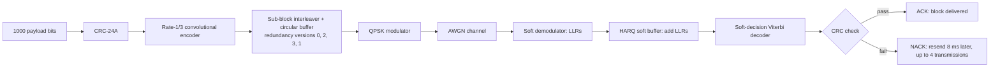
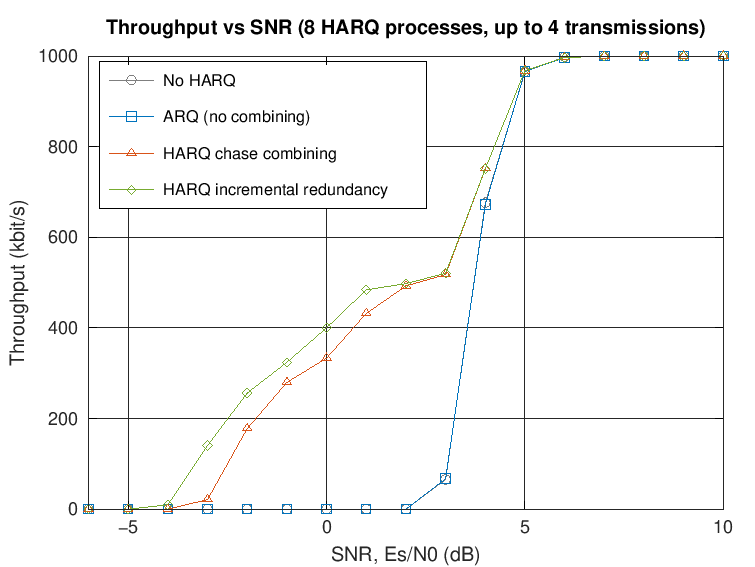
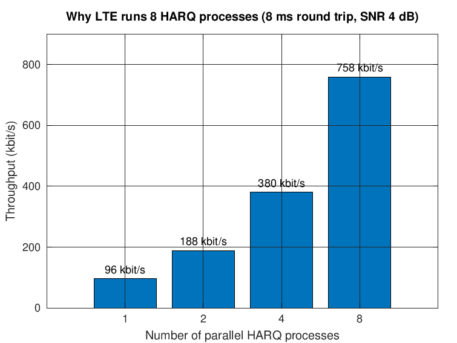

# LTE HARQ Link Simulator (C++)

A link-level simulator of LTE-style **Hybrid ARQ (HARQ)**, written from scratch in C++17 with no external libraries.

It sends transport blocks over a noisy radio channel through **8 parallel stop-and-wait HARQ processes** and compares four retransmission strategies:

| Scheme | What happens when a block fails |
|---|---|
| No HARQ | The block is lost |
| ARQ | The block is resent, and the failed copy is thrown away |
| HARQ, chase combining (CC) | The same coded bits are resent, and the receiver adds the soft information (LLRs) of every copy |
| HARQ, incremental redundancy (IR) | Different coded bits (a new redundancy version) are resent, so each retransmission lowers the effective code rate |

## What it simulates



| Block | Implementation | LTE reference |
|---|---|---|
| CRC | 24-bit CRC-24A, generator 0x864CFB | 3GPP TS 36.212, 5.1.1 |
| Channel coding | Constraint length 7, rate 1/3, generators 133/171/165 (octal) | TS 36.212, 5.1.3.1 |
| Decoding | Soft-decision Viterbi (64 states, add-compare-select, traceback) | — |
| Rate matching | 32-column sub-block interleaver with LTE's column permutation, circular buffer, bit selection with redundancy versions | TS 36.212, 5.1.4.2 |
| Modulation | QPSK with LTE's bit mapping; demodulator outputs LLRs | TS 36.211, 7.1.2 |
| HARQ | 8 processes, 8-subframe round trip, up to 4 transmissions, redundancy version order 0, 2, 3, 1 | TS 36.321 (MAC) |

Default link: 1000 payload bits + 24 CRC bits per block, 1536 coded bits (768 QPSK symbols) per transmission, so the first transmission has code rate 2/3. One block per 1 ms subframe gives a peak of **1000 kbit/s**.

## Results

`make results` runs every experiment (4000 subframes per point). Graphs are drawn by `scripts/plot_results.m`.



| SNR, Es/N0 (dB) | No HARQ | ARQ | Chase combining | Incremental redundancy |
|---:|---:|---:|---:|---:|
| −3 | 0 | 0 | 21 | 141 |
| −2 | 0 | 0 | 178 | 257 |
| −1 | 0 | 0 | 280 | 324 |
| 0 | 0 | 0 | 333 | 401 |
| 2 | 0 | 0 | 493 | 498 |
| 4 | 677 | 673 | 752 | 752 |
| 6 | 999 | 997 | 997 | 997 |

*Throughput in kbit/s.*

What the results show:

1. **Combining is what raises throughput.** Plain ARQ delivers no more data than no HARQ, because every resend is an independent attempt that uses up a subframe. It only reduces lost blocks. With combining, the link keeps delivering data at SNRs **6–7 dB lower** than without HARQ.
2. **Incremental redundancy beats chase combining at low SNR.** At −2 dB it delivers 257 vs 178 kbit/s (+44%). Its second transmission sends the coded bits the first one skipped, completing a rate-1/3 code, while chase combining only repeats the rate-2/3 one.
3. **Incremental redundancy also loses fewer blocks.** At −1 dB it loses 0.3% of blocks after 4 transmissions, compared with 2.4% for chase combining.


### Why LTE runs 8 HARQ processes

A single stop-and-wait process sends a block, then waits 8 ms for the ACK/NACK before it can send again, so the link sits idle 7 subframes out of 8. Running 8 processes in parallel fills every subframe:

| Processes | Throughput at 4 dB (IR) | Subframes used |
|---:|---:|---:|
| 1 | 96 kbit/s | 12.5% |
| 2 | 189 kbit/s | 25% |
| 4 | 381 kbit/s | 50% |
| 8 | 758 kbit/s | 100% |



### Validation

- Uncoded QPSK bit error rate matches the theoretical curve 0.5·erfc(√(Eb/N0)) from 0 to 10 dB (`harq_sim --validate`).
- No undetected errors (CRC passed but data wrong) occurred in any run.
- 67 unit-test checks cover the CRC, the encoder and decoder, rate matching, QPSK, the HARQ state machine and the end-to-end link.


## Build and run

Needs a C++17 compiler (g++ or clang++) and `make`. Tested on Linux with g++ 13 and clang 18.

```bash
make            # builds bin/harq_sim and bin/run_tests
make test       # runs the unit tests
make results    # runs every experiment and writes results/*.csv (a few minutes)
```

Draw the graphs in MATLAB with `run('scripts/plot_results.m')`, or in GNU Octave with `octave-cli scripts/plot_results.m`.

Single runs:

```bash
./bin/harq_sim --scheme ir --snr-start -4 --snr-stop 6 --subframes 8000
./bin/harq_sim --process-sweep --snr 2 --scheme cc
./bin/harq_sim --validate
./bin/harq_sim --help
```

The SNR sweep runs on every CPU core: worker threads take jobs from an atomic counter. Each SNR point's random seed depends only on the SNR value, so a point gives identical results whatever the thread count or sweep range.

## Design choices and simplifications

- **Convolutional code instead of turbo code.** LTE's data channels use a turbo code. This project uses LTE's rate-1/3 convolutional code (from the control channels) with a soft Viterbi decoder, because it is much simpler to implement while still showing how HARQ combining works.
- **Zero-tail termination** instead of LTE's tail-biting, so the decoder always starts and ends in state 0.
- **Redundancy version start positions** are a quarter of the circular buffer apart, a simplified version of LTE's turbo-code rule.
- **Ideal channel conditions:** AWGN only (no fading), a single user, ACK/NACK that is never lost or corrupted, and a fixed modulation and code rate (no link adaptation).
- **Latency** is the time from a block's first transmission to its successful decode, without processing delays.

## Project structure

```
include/, src/
  crc24a          CRC-24A attach and check
  conv_code       rate-1/3 convolutional encoder and soft-decision Viterbi decoder
  rate_matcher    sub-block interleaver, circular buffer, redundancy versions, LLR combining
  modem           QPSK modulator, LLR demodulator, AWGN channel
  harq_process    one stop-and-wait HARQ process (transmit side and soft buffer)
  simulator       the link: 8 processes, subframe loop, statistics
  main.cpp        command-line tool: SNR sweep, process sweep, validation, multithreading
tests/            unit tests (make test)
scripts/          plot_results.m for MATLAB or Octave
results/          CSV output of make results
docs/             graphs and HOW_IT_WORKS.md, a walkthrough of every block
```

## References

- 3GPP TS 36.211: physical channels and modulation (QPSK mapping)
- 3GPP TS 36.212: multiplexing and channel coding (CRC, convolutional code, rate matching)
- 3GPP TS 36.321: medium access control (HARQ)
- MathWorks LTE Toolbox example, "DL-SCH HARQ Modeling", for comparison with a reference HARQ model
